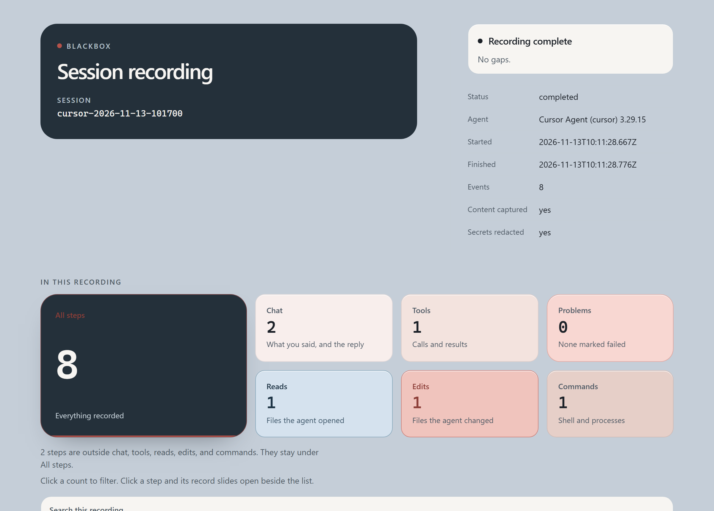
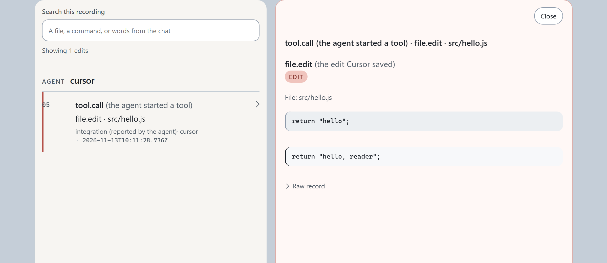

# Blackbox

A local flight recorder for AI agents. It keeps the steps an agent takes, then opens that recording as a dashboard on your computer.



Nothing leaves the machine. Blackbox does not call a model, send telemetry, or ask for an account. There is no database and no product server. A recording is a folder of files.

## Record a Cursor project

Node.js 20 or newer is required. Check with:

```bash
node --version
```

It must show v20 or newer. npm link provides the `blackbox` and `blackbox-on` commands. If you installed Blackbox before, first follow "Upgrading from an older version" below. Do not use `npm link --force`.

```bash
git clone https://github.com/CoreFixGroup/BlackBox.git
```

cd into the cloned folder (named Blackbox by default).

```bash
npm link
```

Confirm the link worked. `blackbox --help` prints the usage text. On macOS or Linux, `which blackbox-on` should print a path. On Windows, `where blackbox-on` should print a path.

Then, in each project:

```bash
blackbox-on
```

The expected output is:

```text
Cursor will record only <project path>
```

That writes `.cursor/hooks.json` for that folder only. Other projects stay off. Restart Cursor, or reload the window, if the project was already open.

From that project folder, run:

```bash
blackbox list
```

It prints `No recordings found.` until an Agent chat has run in that project.

If you move the cloned folder, run `blackbox-on` again in your projects.

Start an Agent chat. The recording dashboard is:

```text
<project>/.blackbox/sessions/cursor-YYYY-MM-DD-HHMMSS/report.html
```

Open `report.html` in a browser. The page is one file.

## Upgrading from an older version

Delete the old `blackbox-on` command left by the previous build before you run `npm link`.

- Windows: delete `%APPDATA%\npm\blackbox-on.cmd`, and `blackbox-on` and `blackbox-on.ps1` in that same folder if they are present.
- macOS and Linux: delete `~/.local/bin/blackbox-on`.

On Windows the old file blocks `npm link`, and on macOS and Linux it can still run old code if `~/.local/bin` comes first in `PATH`.

## Install as a Cursor plugin

From the Marketplace, once Blackbox is approved: open Customize, search for Blackbox, and choose Install.

To test it locally before that, from the cloned Blackbox folder run:

```bash
npm run plugin:local
```

That copies the plugin into `~/.cursor/plugins/local/blackbox` on macOS and Linux, or `%USERPROFILE%\.cursor\plugins\local\blackbox` on Windows, and replaces an older copy. Restart Cursor, or reload the window.

Node.js 20 or newer must be installed and on `PATH`. The hook runs `node`. Without Node, nothing is recorded.

Recordings stay in `<project>/.blackbox` and are git-ignored automatically. Nothing is uploaded. Object keys named `authorization`, `apiKey`, `api_key`, `token`, `password`, `secret`, and `accessToken` are replaced with `[REDACTED]`. String values that look like `sk-...`, `Bearer ...`, `AKIA...`, or `ghp_...` are replaced the same way. Other secrets, for example `.env` lines, private keys, JWTs, `github_pat_` tokens, and passwords in normal text, may still be stored. Chain-of-thought is never stored. Blackbox keeps only its length and duration.

See a recording with `/blackbox-report`, or open `report.html` in the session folder. Run `/blackbox-report` from the project. It opens the newest dashboard and replies with the session id and path. It does not read or summarize the recording.

To turn it off, uninstall the plugin in Customize. For a local install, delete the copied folder instead. Reload Cursor. Delete `<project>/.blackbox` folders to remove old recordings.

Cursor's CLI does not run plugin hooks yet. CLI users should use `blackbox-on`.

If you used `blackbox-on` before, the plugin stays quiet in those projects, so nothing is recorded twice.

## Read the dashboard

The counts are filters. **Reads** are files the agent opened. **Edits** are files it changed. They are separate, and each has its own color. Chat, tools, commands, and problems work the same way.

Click a step and the full record slides open beside the list. Close it, or click the same step again, and the list goes back to full width.



Search narrows whatever filter is selected. Technical names stay as they are, with a short meaning in brackets. The raw JSON stays behind **Raw record**.

A Cursor recording includes the prompt, the reply, tool calls, a clipped file preview, file edits, shell output, and MCP results. A search stores the pattern and whether it succeeded. Cursor does not send the matching lines. File previews are cut at 8,000 characters. Thinking text is not stored. The hook allows every agent action. If the hook fails, the agent still runs.

A folder named `cursor-YYYY-MM-DD-HHMMSS` is the local time the recording started. A chat that is still open stays `running`, and the page says the recording is incomplete. That means the file is not closed yet. It does not mean the agent failed.

## Give this folder to someone else

Send the repository. Do not send `node_modules` or `.blackbox`. They need Node.js 20. They clone it and run `npm link`. In each project they want recorded, they run `blackbox-on`. If the cloned folder moves, they run `blackbox-on` again in those projects.

## Use it from your own agent

```typescript
import { Blackbox } from "blackbox";

const blackbox = Blackbox.open({
  directory: ".blackbox",
  redactSecrets: true,
  captureContent: true,
});

const session = blackbox.startSession({
  agent: { id: "my-agent", name: "My Agent", version: "0.1.0" },
});

session.recordUserMessage({ content });
session.recordModelRequest({ provider, model, input });
session.recordModelResponse({ output, parentEventId });
session.recordToolCall({ name, callId, arguments });
session.recordToolResult({ callId, output, isError });
session.recordError({ message, parentEventId });
session.recordAssistantMessage({ content });
session.finish({ status: "completed" });
```

Blackbox records a call, a directory, or a child process only after the integration opts in. It does not scan the machine, decrypt HTTPS, or open a database. Events are marked `integration`, `protocol`, `environment`, or `replay`. Outcome checks are written beside the recording, not into the event file.

`wrapModel` records the request and the response. A promise stays a promise, and an async generator stays an async generator. A stream records each `model.stream.delta`, then one `model.response` with the joined text. Leaving the stream early records that it ended before completion.

`wrapTool` records the call and the result. A thrown tool records an error result and an error event, then throws the original error. `runWithRetry` runs the existing function again and records the retry. It does not replace the agent's own result.

`handoff` records the handoff, runs the child on the same session, and records `agent.completed` when the child did not already call `complete`. Events inside the handoff use the child agent id. `complete` records that the current agent finished and leaves the session open. `finish` still closes the whole session.

`captureHttp` records `fetch` and Node `http`/`https` requests for this session only, then restores them on `finish`. A JSON body with `model` and `messages` also records `model.request` and `model.response`. A body with `jsonrpc` records `jsonrpc.request` and `jsonrpc.response`. `wrapMcp` records `request` and `callTool` on an object you pass in.

`openProxy` listens on `127.0.0.1` and closes on `finish`. Plain HTTP is recorded. `CONNECT` is recorded as the target host and port and is not decrypted.

`watchDirectory` snapshots a directory, including `node_modules`, `.git`, and symbolic links that stay inside that directory. On `finish` it records created, modified, and deleted files. A git checkout records `environment.git`, with both sides of a rename listed. A directory that is not a repository records that fact. If `git` is not installed, one error is recorded and the session still finishes. `wrapSpawn` records `spawn`, `spawnSync`, `exec`, `execSync`, `execFile`, `execFileSync`, and `fork`, including calls made through Node's `child_process` module while the session is open. A child that is still running at `finish` is recorded with a null exit code. The process environment is not stored.

`blackbox.replay(sessionId)` opens a new session and serves stored model responses. The new model request is marked `generated` and the stored response is marked `replayed`. Stored tool results are matched by tool name in the order they were recorded. A tool the recording does not contain still runs, and its result is `generated`. `replay.run` makes `fetch`, Node HTTP, and `net.connect` throw before a socket opens. Each blocked call is recorded.

`blackbox.compare` aligns two recordings by event type, then by order within that type. An extra event does not make later events of a different type look different. Recorder-assigned `callId` values are not treated as a difference. `injectFault` makes the next matching wrapped model or tool throw once, and records `fault.injected` first.

`blackbox.verify` appends checks to `verification.jsonl`. Built-in checks are file exists, file SHA-256, and git HEAD. A custom check is a function. Blackbox stores the boolean and the short message. The recording file is not modified.

Each record method returns the stored event, including its `id`. Pass that id as `parentEventId` to link a later event. A tool result that only has `callId` is linked to the matching tool call from the same session.

`finish` closes the session. The session is marked finished only after the header is updated on disk. If that write fails, call `finish` again. The `session.finished` event is not written a second time. A gap already in the event file does not block `finish`. The session still closes, and `complete` stays false while the gap remains. Call `finish({ status: "failed" })` when the agent stops because of an error and the events on disk are still the full story. `complete: true` means the recording was closed and the file is consistent. It does not mean the agent task succeeded.

There is no field for hidden model reasoning. Do not put chain-of-thought into the recorded payloads.

### Content and secrets

`captureContent: false` keeps names, ids, types, tool names, error names, and retry attempt numbers. It replaces payload fields (`content`, `input`, `output`, `arguments`, `details`, `data`, `message`, `reason`, `summary`, `delta`, `task`, `body`, `headers`) with `{ "omitted": true, "byteLength": N }`. `byteLength` is the UTF-8 size of `JSON.stringify` of the original value. The finish summary is omitted too, so it is not copied onto the session header.

`redactSecrets: true` runs before the write. Object keys named `authorization`, `apiKey`, `api_key`, `token`, `password`, `secret`, and `accessToken` are replaced with `[REDACTED]`. String values that look like `sk-...`, `Bearer ...`, `AKIA...`, or `ghp_...` are replaced the same way. Other secrets, for example `.env` lines, private keys, JWTs, `github_pat_` tokens, and passwords in normal text, may still be stored. The value returned by a record method is the stored value, after omission and redaction.

## Storage

```text
.blackbox/sessions/<sessionId>/session.json
.blackbox/sessions/<sessionId>/events.jsonl
.blackbox/sessions/<sessionId>/report.html
```

`session.json` is the header: schema version, agent, status, timestamps, content and redaction flags, and, after finish, the event count. It is replaced by writing a temporary file and renaming it.

`events.jsonl` is append-only. Each line is one event. The recorder assigns `sequence` starting at 1 and flushes the line. On finish it flushes the event file, then updates the header. A crash before that update leaves status `running`.

One process should write a session. `export.json` is written when you export. For Cursor, the hook writes `report.html` as the chat runs and again when the chat ends. For a custom agent, `report.html` is written when you ask for a report.

## Event model

Schema version is `1`. A stored event has:

| Field | Meaning |
| --- | --- |
| `id` | Event id |
| `sessionId` | Recording id |
| `sequence` | Order assigned by Blackbox |
| `type` | Event name |
| `timestamp` | When Blackbox stored it, ISO-8601 |
| `source` | `integration`, `protocol`, `environment`, `replay`, or `verification` |
| `agentId` | Agent that reported it |
| `parentEventId` | Optional link to an earlier event |
| `data` | Payload for that type |

Known types include `http.request`, `http.response`, `http.connect`, `mcp.request`, `mcp.response`, `jsonrpc.request`, `jsonrpc.response`, `environment.file`, `environment.git`, `environment.process`, and `fault.injected`, plus messages, model calls, tool calls, and errors. A reader still returns events whose type it does not know.

## Integrity

A recording is complete only when all of these are true:

- status is `completed` or `failed`
- every JSONL line is valid
- sequences are `1..N` with no gaps
- the header event count and last sequence match the file

A chopped final line is dropped and reported as a gap. The events before it remain readable. An event whose `source` is not one of the known sources, or whose session id does not match the folder, is still shown and is also a gap. A corrupt `session.json` is reported as incomplete and does not prevent other sessions from being listed.

## Export

`blackbox export` writes one JSON document:

```json
{
  "schemaVersion": 1,
  "exportedAt": "2026-01-01T00:00:00.000Z",
  "session": {},
  "events": [],
  "integrity": { "complete": true, "eventCount": 0, "gaps": [] }
}
```

`events` stays in sequence order. The default file is `export.json` inside the session folder. `--out` writes somewhere else when you ask it to.

## Commands

```text
blackbox list [--dir <path>]
blackbox show <sessionId> [--dir <path>]
blackbox export <sessionId> [--dir <path>] [--out <file>]
blackbox report <sessionId> [--dir <path>] [--out <file>]
blackbox compare <sessionId> <sessionId> [--dir <path>]
blackbox verify <sessionId> [--dir <path>] [--exists <path>] [--sha256 <path>=<hex>] [--git-head <path>=<commit>]
```

The default directory is `.blackbox`. `show` prints the session, the integrity result, and the events in order.

People who install with `npm link` never need to build. Building is only for people changing the source code:

```bash
npm install
npm run build
npm run check:dist
```

During that work, the same commands also run from the source:

```bash
npm run blackbox -- list
npm run blackbox -- report <sessionId>
```

These demos stay on the machine. None of them call a model:

```bash
npm run demo
npm run demo:instrumented
npm run demo:proxy
npm run demo:crud
npm run demo:cursor
```

`demo` reports a fixed execution. `demo:instrumented` wraps an existing agent's model, tools, retry, and handoff. `demo:proxy` sends one request through a localhost proxy to a local stub. `demo:crud` creates, reads, updates, and deletes files, then checks the result. `demo:cursor` feeds one sample Cursor hook sequence through the adapter. Recordings stay in `.blackbox/` until you delete them.

## Tests

```bash
npm test
```

The tests use temporary directories. They cover sequence and reload, unfinished sessions, a truncated line, a bad event count, redaction, payload omission, the demos, wrapped streaming, handoffs, protocol capture, the local proxy, directory and process diffs, replay, comparison, verification, export, the HTML report, the CLI, and Cursor hooks.
